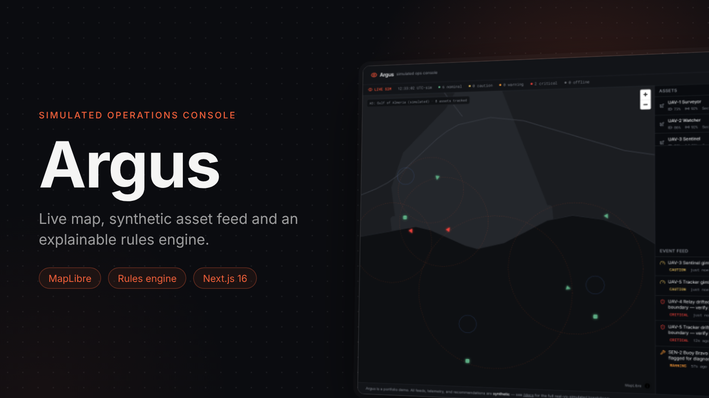
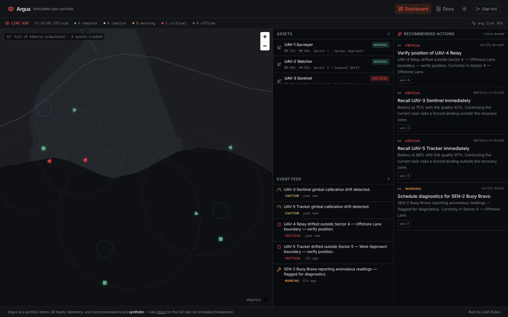
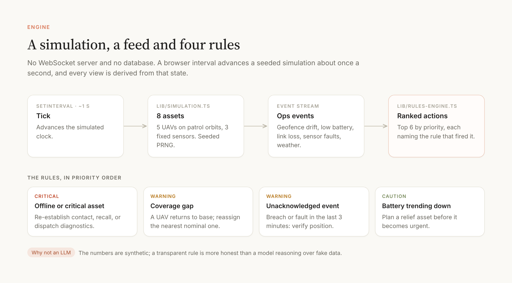

# Argus



**A simulated operations console.** Named for the hundred-eyed giant of Greek myth, Argus fuses many simulated eyes (five drones and three fixed sensors) into one map-first operator screen: a live map, a status bar, an asset list, a ticking event feed and a panel of recommended actions, each one showing the rule that produced it.

Part of [Siegfried](https://github.com/joshrubio/Siegfried), the fifth and last of its satellite projects. Case study: [joshrubio.es/projects/argus](https://joshrubio.es/projects/argus)

It is **a portfolio piece with a synthetic feed, not a real monitoring system**, inspired by the general shape of situational-awareness tools rather than any specific product. The full real-vs-simulated breakdown is on `/docs` inside the app.



*README screenshots were captured with a simplified fallback basemap; the running app shows CARTO's full dark-matter map.*

## What's real

- **The map**: [MapLibre GL JS](https://maplibre.org/) on [CARTO's free dark-matter basemap](https://github.com/CartoDB/basemap-styles), built on OpenStreetMap data. No account or token.
- **The geography**: the area of operations is centred on the real coastline near Almería, Spain, chosen purely as a legible backdrop.
- **The login gate**: a real cookie-based session gate that restricts the dashboard route (though, as below, it isn't real auth).

## What's simulated

- **Every asset.** Five UAVs on circular patrol orbits and three fixed sensor posts, all produced in the browser by a small seeded simulation (`lib/simulation.ts`). Nothing is fetched from a real drone, sensor or feed.
- **The live feel.** No WebSocket server and no database: a client-side interval ticks the simulation about once a second.
- **The event feed.** Geofence drift, low battery, link degradation, sensor faults, calibration drift and weather notices, generated at low, tunable probabilities and framed as neutral operations and logistics events, never as anything resembling targeting.
- **The login.** Any input, or none, signs you in.

## The engine



The recommendation panel is a deterministic rules engine (`lib/rules-engine.ts`), not an LLM call. Four rules are evaluated against the simulated state every tick, ranked by priority, and each recommendation cites the exact numbers behind it:

| Rule | Fires when | Suggests |
|---|---|---|
| Critical asset | An asset is offline or critical | Re-establish contact, recall or run diagnostics |
| Coverage gap | A drone returns to base or drops out | Reassign the nearest nominal drone |
| Unacknowledged event | A breach or fault in the last 3 minutes | Verify position or schedule diagnostics |
| Battery trend | A drone on task reaches caution level | Plan a relief asset ahead of time |

A model call was skipped on purpose: a transparent rule is more honest than a model reasoning over numbers that are already synthetic.

## How it was built

Argus is the only satellite built entirely by a remote Claude Code agent, from a single self-contained brief that restated the whole Siegfried playbook (benchmark first, the Next.js 16 pattern, the demo auth gate, known gotchas). The result was then reviewed in the browser, registered in Siegfried and documented in its vault.

## Identity

Benchmarked against NASA's [Open MCT](https://github.com/nasa/openmct) (dense, telemetry-first panels), Grafana's dark theme (near-black panels, tight radius, one reserved accent) and MarineTraffic's 2023 redesign (a map-first canvas with docked panels). A warm signal red-orange accent reserved for the accent and critical status, Inter for UI with Roboto Mono for telemetry and IDs, a small 0.4rem radius, and deliberate density.

The map stays dark even in light mode, like a radar scope regardless of room lighting.

## Running locally

```bash
npm install
npm run dev
```

Open [http://localhost:3000](http://localhost:3000). No API keys are needed, and the login gate accepts any input.

```bash
npm run build   # production build
npm run lint    # eslint
```

## Stack

Next.js 16 (App Router, Cache Components) · TypeScript · Tailwind CSS v4 · shadcn/ui-style components on `@base-ui/react` · MapLibre GL JS + CARTO tiles · a hand-rolled simulation and rules engine · cookie-based demo auth (`proxy.ts`).
